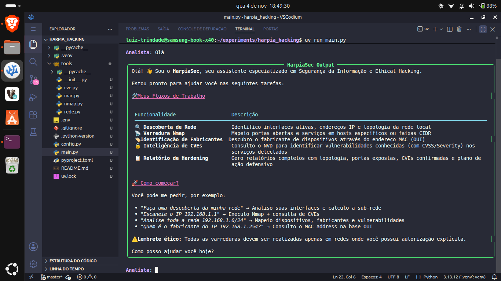

# 🛡️ HarpiaSec — Agente de IA para Ethical Hacking e Auditoria de Rede

[](https://www.python.org/)
[](https://github.com/astral-sh/uv)
[](https://www.maritaca.ai/)
[](https://www.langchain.com/)
[](LICENSE)

O **HarpiaSec** é um agente autônomo de inteligência artificial voltado para segurança defensiva, hacking ético e auditoria de redes locais. Utilizando o modelo **Sabiazinho-4** da **Maritaca AI** em _flex mode_ via **LangChain**, o agente orquestra ferramentas do sistema operacional (Nmap, ARP/OUI, interfaces de rede) e APIs públicas de inteligência de ameaças (NVD/NIST) para diagnosticar vulnerabilidades e fornecer planos completos de _hardening_.

---

## 📸 Interface CLI



```text
╭───────────────────────────────────────────────────────────────────────╮
│ 🛡️  HarpiaSec - IA Agent para Ethical Hacking                          │
│ Modelo: Sabiazinho-4 (Flex) | Tools: Discovery, Nmap, NVD CVE & MAC OUI │
╰───────────────────────────────────────────────────────────────────────╯
```

---

## 🛠️ Funcionalidades & Arquitetura de Ferramentas

O projeto utiliza uma arquitetura modularizada onde cada ferramenta (_Function Tool_) possui responsabilidade única em seu próprio arquivo dentro do módulo `tools/`.

| Arquivo         | Ferramenta (`@tool`)       | Descrição                                                                                        |
| --------------- | -------------------------- | ------------------------------------------------------------------------------------------------ |
| `tools/rede.py` | `obter_informacoes_rede`   | Mapeia interfaces ativas, endereços IP e sub-redes via `ifconfig` / `ip addr`.                   |
| `tools/nmap.py` | `executar_nmap_scan`       | Injeta argumentos customizados no `nmap` para varreduras de portas, serviços e versões.          |
| `tools/mac.py`  | `consultar_fabricante_mac` | Extrai o MAC address da tabela ARP local (`ip neighbor`) e identifica o fabricante via base OUI. |
| `tools/cve.py`  | `consultar_cve_servico`    | Consulta a API REST v2 do NVD (NIST) para encontrar CVEs, severidades e pontuações CVSS v3.1.    |

---

## 📂 Estrutura do Projeto

```text
harpia_hacking/
├── tools/
│   ├── __init__.py      # Exportação concentrada de ALL_TOOLS
│   ├── cve.py           # Consulta NVD API v2
│   ├── mac.py           # Resolução MAC ARP & OUI Lookup
│   ├── nmap.py          # Wrapper de execução do Nmap
│   └── rede.py          # Coleta de interfaces locais
├── .env                 # Variáveis de ambiente (chaves de API)
├── .gitignore
├── .python-version
├── config.py            # Prompt do sistema e configurações do LLM
├── main.py              # Interface CLI (Rich) e loop de interação
├── pyproject.toml       # Dependências e metadados do projeto
└── uv.lock

```

---

## 🚀 Instalação e Execução

### Pré-requisitos

1. **Python 3.11+**
2. **Nmap** instalado no sistema operacional:

```bash
sudo apt install nmap   # Ubuntu/Debian/Linux Mint

```

3. Gerenciador de pacotes **`uv`**:

```bash
curl -LsSf [https://astral.sh/uv/install.sh](https://astral.sh/uv/install.sh) | sh

```

### Passo a Passo

1. **Clone o repositório:**

```bash
git clone [https://github.com/seu-usuario/harpia-sec.git](https://github.com/seu-usuario/harpia-sec.git)
cd harpia-sec

```

2. **Configure o arquivo de ambiente (`.env`):**
   Crie um arquivo `.env` na raiz do projeto contendo a sua chave da Maritaca AI:

```env
MARITACA_API_KEY=sua_chave_de_api_maritaca_aqui

```

3. **Execute a aplicação:**
   O `uv` criará o ambiente virtual e instalará todas as dependências automaticamente:

```bash
uv run main.py

```

---

## 💡 Exemplos de Prompts no Terminal

Após iniciar a CLI do HarpiaSec, você pode interagir com linguagem natural:

- **Descoberta de rede local:**

  > _"Analise a minha rede local e mapeie os dispositivos ativos."_

- **Varredura direcionada + Inteligência de CVEs:**

  > _"Faça uma varredura no IP 192.168.0.1 e verifique se existem vulnerabilidades conhecidas."_

- **Identificação de fabricante:**

  > _"Descubra quem é o fabricante do dispositivo no IP 192.168.0.254."_

- **Auditoria completa de segurança:**
  > _"Execute um escaneamento completo da sub-rede, consulte CVEs para os serviços encontrados e me entregue um relatório de hardening."_

---

## ⚠️ Disclaimer Ético

Esta ferramenta foi desenvolvida exclusivamente para **fins educacionais, auditorias defensivas autorizadas e segurança preventiva**. O uso do HarpiaSec contra redes ou alvos sem autorização prévia e explícita do proprietário é estritamente proibido. Os desenvolvedores não se responsabilizam pelo uso indevido deste software.

---

## 📜 Licença

Este projeto está licenciado sob a Licença **MIT** — consulte o arquivo [LICENSE](https://www.google.com/search?q=LICENSE) para obter mais detalhes.
# harpia_hacking
